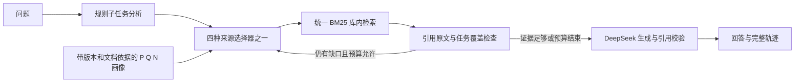

# 架构与可解释边界

所有方法共用 `Agent` 编排。查询分析器从问题文本得到任务，库内 BM25 只读文档标题和正文，不读支持标签。证据检查器在取回文档后读取合成事实标签，并验证其引用文字确实存在于原文。它能拒绝只有相近主题但不支持事实的干扰文档；它不是适用于任意自然文档的通用蕴含模型。

动态边界 `N_i(q,c_t)` 由当前缺失任务集合、版本化支持映射和已访问状态计算。每库日志记录适用任务、确认不支持的任务、未知任务与原文依据。只有本轮仍缺的任务计入覆盖增益，已有证据不重复增加价值。未命中不会修改持久画像。

动态排序分为 `0.35*positive + covered_fraction - 0.55*conflict - 0.04*visits`。冲突是已确认不支持比例，加未知比例的0.25倍。集合选择先最大化新增任务覆盖，再用分数打破平局，重复直到无法增加覆盖。无法识别的任务会保留并触发一次一个库的探索。

这比全问题固定黑名单更细，但仍是规则版近似；增益也可能来自显式任务支持矩阵和覆盖策略，不可全部归因于负向边界。未来需要相同集合选择器下有无 N 的严格消融。

`all` 每轮调用所有库；`positive` 首轮仅用P/Q相似度选 top-k；`fixed` 对整条查询命中固定负向模式做软惩罚，再取 top-k。后两者在缺证据时优先未访问库，全部访问后可同库分页。所有方法共享问题改写（使用未解决任务的标签）、去重与停止逻辑。

局部文本量、模块耗时与模型实际 usage 分开记录。原文传给回答器前已按任务过滤，因此全库检索增加的是检索与检查工作，不必然增加模型 token。这是本实现的特征，也是评估动态路由是否真的省总成本时必须考虑的因素。
